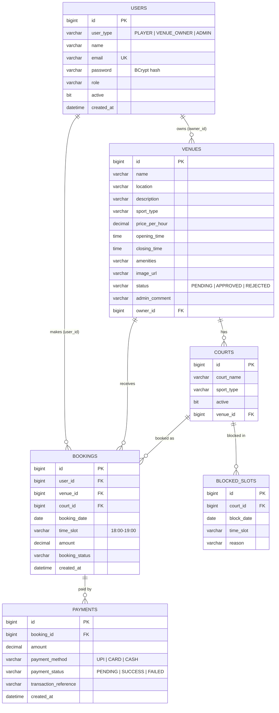

# 5. Database Schema

Database: **MySQL 8**, name `quickcourt`. Tables are created automatically by Hibernate. Reference DDL: `database/schema.sql`.

## 5.1 ER diagram

## 5.2 Entities required by the brief
| Required entity | Implemented as | Notes |
|---|---|---|
| User (id, name, email, password, role, createdAt) | `users` / `User` + 3 subclasses | `active` added for ban/unban |
| Venue (…, owner, status) | `venues` / `Venue` | opening/closing hours, amenities, image, admin comment added |
| Court (id, courtName, sportType, venue) | `courts` / `Court` | `active` added (soft delete) |
| Booking (…) | `bookings` / `Booking` | |
| Payment (…) | `payments` / `Payment` | |
| *(extra)* BlockedSlot | `blocked_slots` | needed for the owner's "block time slots for maintenance" |

## 5.3 Normalisation (short note)
- **1NF:** every column holds one value (exception: `venues.amenities` is a comma-separated text for MVP simplicity; normalise to an `amenities` table later).
- **2NF/3NF:** venue data lives only in `venues`, court data only in `courts`; bookings reference them by id, so changing a venue name does not require updating bookings.

## 5.4 Sample data (created by `DataSeeder`)
- 6 users: 1 admin, 2 owners, 3 players (password rules shown in README).
- 7 venues in Ahmedabad: 6 APPROVED (badminton, football, tennis, cricket, table tennis, basketball) and 1 PENDING ("Ace Badminton Studio").
- 14 courts, 7 bookings (past, future, one cancelled) with matching payments.

## 5.5 Useful queries
See `database/useful_queries.sql` (users, pending venues, booking history, revenue per venue, a query that proves there are no double bookings).
