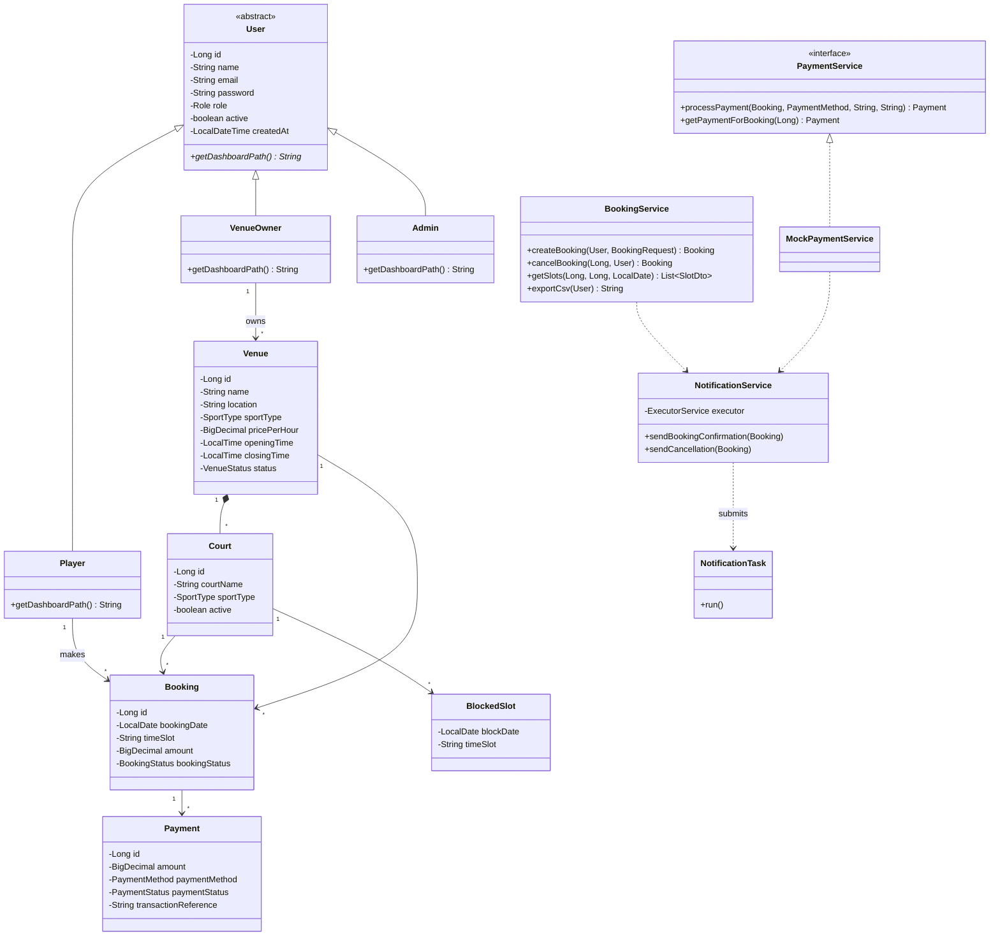
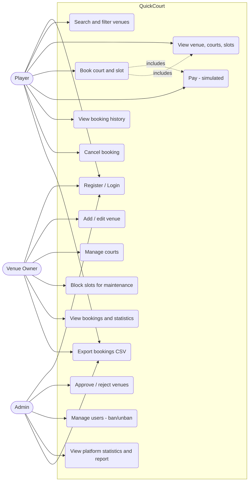
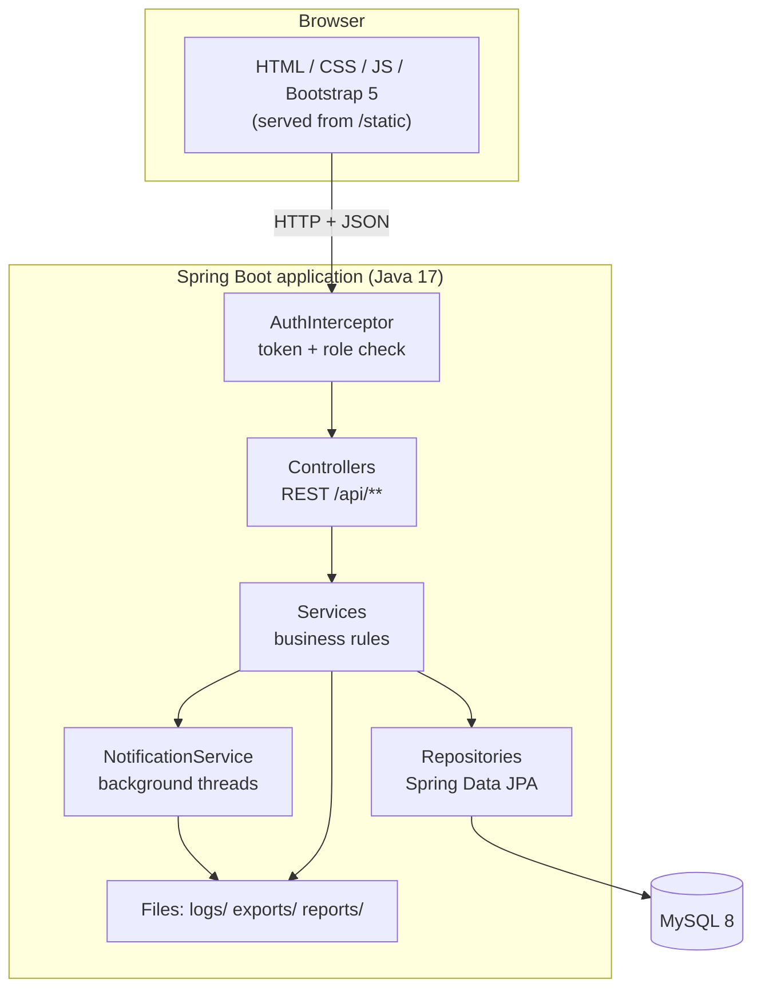
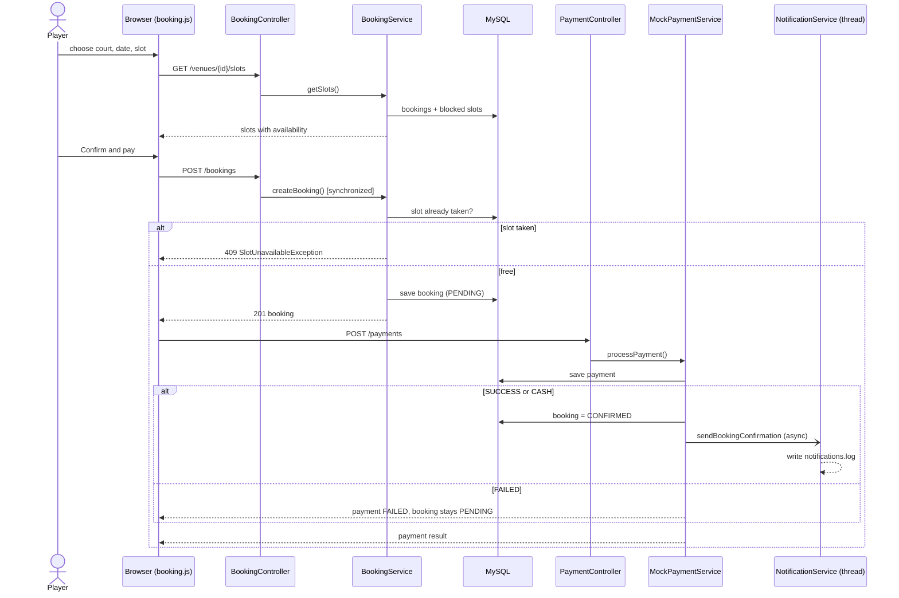

# 6. UML and Architecture Diagrams

(Mermaid diagrams: GitHub and VS Code (extension *Markdown Preview Mermaid Support*) render them. For the report, take screenshots or paste the code into https://mermaid.live and export PNG/SVG.)

## 6.1 Class diagram

## 6.2 Use case diagram

## 6.3 Architecture diagram

## 6.4 Sequence diagram — booking and payment

