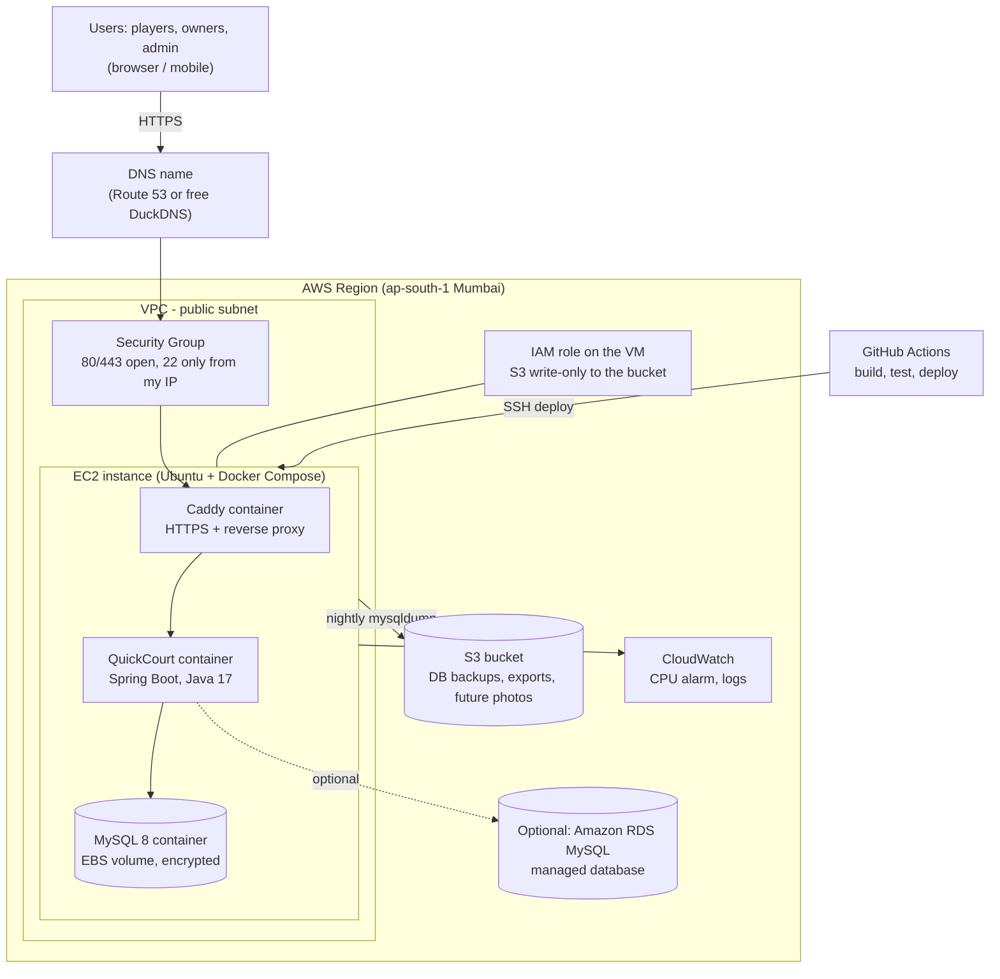

# 7. Cloud Deployment Guide (AWS) — QuickCourt

This document covers every cloud item in the brief: architecture, containerisation, deployment, storage and database, security, scalability, backup, monitoring, CI/CD and cost.
> You must do the actual deployment in **your own cloud account**. Follow the steps and keep screenshots as evidence.

## 7.1 Why the cloud, and why AWS?
- **Reach and availability:** players and owners reach QuickCourt from anywhere, any time (booking apps are used at night and weekends).
- **Scalability:** weekend evening peaks can be handled by adding capacity instead of buying hardware.
- **Pay-as-you-go:** a startup starts at near-zero cost and grows with users.
- **Why AWS:** the most widely used provider (good for the CV), and new accounts currently get **free credits** (as of Nov 2026 AWS advertises up to about **US$200** in credits and a Free plan valid up to **6 months**, with a hard stop at the credit limit — *verify current terms on https://aws.amazon.com/free before you sign up*). Alternatives with student programmes: Azure for Students, Google Cloud free tier, Oracle Cloud free tier — the same Docker setup works on all of them.

**Service models used:** **IaaS** (EC2 virtual machine we manage, with Docker), **PaaS-like managed services** (S3 object storage, optional RDS managed MySQL, CloudWatch monitoring). *Serverless/SaaS not used* because the Spring Boot app is a long-running server and containers keep it portable.

## 7.2 Architecture diagram

**Component justification**
| Component | Why |
|---|---|
| EC2 `t3.micro/small` | Cheapest always-on VM that runs Docker; full control for a learning project |
| Docker + Compose | Same containers on laptop and cloud; one command to start/upgrade |
| Caddy | Free automatic HTTPS (Let's Encrypt) with a 3-line config |
| MySQL container + EBS volume | Same engine as local development, free on the VM; **RDS option** below for a managed database |
| S3 | Durable, cheap object storage for backups/exports/uploads, encrypted by default |
| IAM role | VM gets S3 permission without access keys stored anywhere |
| CloudWatch | Basic metrics and alarms (CPU, status check) |

## 7.3 Containerisation (files in the repo)
- `Dockerfile` — multi-stage: Maven builds the JAR, then a slim JRE image runs it as a **non-root user**.
- `docker-compose.yml` — local: MySQL + app.
- `deploy/docker-compose.prod.yml` — cloud: MySQL (no public port) + app (not public) + Caddy (80/443).
Test locally first: `docker compose up --build` → http://localhost:8080.

## 7.4 Step-by-step deployment on AWS EC2

### Step 1 — Account, safety first
1. Create an AWS account (or your institution's account). Turn on **MFA** for the root user and do not use root for daily work.
2. **Billing → Budgets → Create budget** (e.g. US$5 monthly, alert at 80 %). The brief requires a budget alert.
3. Choose region **Asia Pacific (Mumbai) `ap-south-1`** (closest to Ahmedabad).

### Step 2 — Network and VM
1. **EC2 → Launch instance**: Ubuntu Server 24.04 LTS, type `t3.micro` (use `t3.small` if credits allow — Spring Boot + MySQL are comfortable with 2 GB RAM), 20 GB gp3 storage (**tick "Encrypted"**).
2. Create a **key pair** (`.pem`) and keep it private (never commit it).
3. **Security group:** inbound `22` from **My IP only**, `80` and `443` from anywhere. Do **not** open 3306 or 8080.
4. Allocate and attach an **Elastic IP** so the address does not change.
5. Add 1 GB swap if you use 1 GB RAM: `sudo fallocate -l 1G /swapfile && sudo chmod 600 /swapfile && sudo mkswap /swapfile && sudo swapon /swapfile`.

### Step 3 — A domain name (needed for HTTPS)
Free option: https://www.duckdns.org → create e.g. `quickcourt-team.duckdns.org` → point it to the Elastic IP. (Or Route 53 / any registrar.)

### Step 4 — Install Docker on the VM
```bash
ssh -i quickcourt-key.pem ubuntu@<ELASTIC_IP>
curl -fsSL https://get.docker.com | sudo sh
sudo usermod -aG docker ubuntu && exit        # log in again so the group applies
```

### Step 5 — Get the code and configure secrets
```bash
git clone https://github.com/<you>/quickcourt.git && cd quickcourt     # private repo: use a deploy key or token
cp .env.example .env && nano .env
```
In `.env` set strong values for `DB_PASSWORD`, `DB_ROOT_PASSWORD`, `DOMAIN`, `BACKUP_BUCKET`, and `SEED_DATA=true` **only for the demo** (it creates fake users with known passwords — set `false` and re-create the DB for real use).

### Step 6 — Start everything
```bash
docker compose --env-file .env -f deploy/docker-compose.prod.yml up -d --build
docker compose -f deploy/docker-compose.prod.yml ps
docker compose -f deploy/docker-compose.prod.yml logs -f app      # wait for "Started QuickCourtApplication"
```
Open `https://<your-domain>` — Caddy obtains the certificate on first request (give it a minute).

### Step 7 — Post-deployment smoke test
```bash
bash deploy/smoke-test.sh https://<your-domain>
```
Also do SYS-08 from the test cases (book a court in the browser). Screenshot the result for the report.

### Step 8 — Object storage and backups (S3)
1. **S3 → Create bucket** `quickcourt-backups-<yourname>`; keep **Block all public access ON**; default encryption **SSE-S3**; enable **Versioning**; add a **Lifecycle rule** (expire objects after 30 days).
2. **IAM → Roles → Create role** for EC2 with this policy (replace the bucket name), attach it to the instance (*Actions → Security → Modify IAM role*):
```json
{ "Version": "2012-10-17",
  "Statement": [{ "Effect": "Allow",
                  "Action": ["s3:PutObject", "s3:GetObject", "s3:ListBucket"],
                  "Resource": ["arn:aws:s3:::quickcourt-backups-yourname", "arn:aws:s3:::quickcourt-backups-yourname/*"] }] }
```
3. Install the AWS CLI on the VM (`sudo snap install aws-cli --classic`), then run `bash deploy/backup.sh` once and check the file appears in S3.
4. Schedule nightly: `crontab -e` → `0 2 * * * cd /home/ubuntu/quickcourt && bash deploy/backup.sh >> backup.log 2>&1`.

### Step 9 — Optional: managed database (Amazon RDS)
For a managed DB (automatic backups, patching, optional Multi-AZ): create **RDS → MySQL 8** (`db.t3.micro`, **encryption enabled**, **not publicly accessible**, security group allowing 3306 **only from the EC2 security group**). In `.env`/compose set:
```
DB_URL=jdbc:mysql://<rds-endpoint>:3306/quickcourt?useSSL=true&serverTimezone=UTC
DB_USERNAME=<rds user>   DB_PASSWORD=<rds password>
```
and remove the `db` service from the compose file. (Check RDS free-tier eligibility in your account — free plans change.)

### Step 10 — Clean-up after the final demo (avoid charges!)
Terminate the EC2 instance, release the Elastic IP, delete RDS (take a final snapshot only if needed) and old snapshots/volumes, empty and delete the S3 bucket, then check **Billing → Bills** the next day.

## 7.5 Environment variables
| Variable | Purpose | Example / default |
|---|---|---|
| `DB_URL` | JDBC URL | `jdbc:mysql://db:3306/quickcourt?...` |
| `DB_USERNAME`, `DB_PASSWORD` | DB credentials | from `.env`, never in Git |
| `DB_ROOT_PASSWORD` | MySQL root (container only) | from `.env` |
| `SEED_DATA` | Insert demo data on empty DB | `true` demo / `false` real |
| `PORT` | HTTP port | `8080` |
| `DDL_AUTO` | Hibernate schema mode | `update` (use `validate` + Flyway in production) |
| `LOG_DIR`, `EXPORT_DIR`, `REPORT_DIR` | File locations (mounted as Docker volumes) | `logs`, `exports`, `reports` |
| `DOMAIN` | Public domain for Caddy | `quickcourt-team.duckdns.org` |
| `BACKUP_BUCKET` | S3 bucket for backups | `quickcourt-backups-yourname` |
For a stronger setup, keep secrets in **AWS Systems Manager Parameter Store / Secrets Manager** and load them at deploy time.

## 7.6 Security recommendations
| Area | What we do / recommend |
|---|---|
| **Access control (IAM)** | MFA on root; day-to-day IAM user with least privilege; EC2 uses an **IAM role** with S3-only permission; no access keys on the VM |
| **Secrets** | `.env` on the server (git-ignored); nothing hard-coded in the repo; rotate passwords; optionally SSM Parameter Store |
| **Network** | Security group: only 80/443 public, SSH from my IP; DB not published; app only reachable through Caddy |
| **In transit** | HTTPS via Caddy/Let's Encrypt; use `useSSL=true` for RDS connections |
| **At rest** | Encrypted EBS volume; S3 SSE-S3; RDS storage encryption; BCrypt-hashed passwords |
| **Application** | Input validation, role checks, escaped output, non-root container, restricted metrics endpoint |
| **Operations** | OS updates (`sudo apt update && sudo apt upgrade`), image updates, `SEED_DATA=false`, delete unused resources |
| **Improvements** | AWS WAF/rate limiting, fail2ban for SSH, session store in Redis/JWT, audit logging |

## 7.7 Monitoring and logging
| What | How | Show in demo |
|---|---|---|
| Health | `GET /actuator/health` → `{"status":"UP"}`; free external check with UptimeRobot / Route 53 health check | browser tab |
| Usage metric | `GET /actuator/metrics/http.server.requests` (request count, latency) — reachable on the VM via `curl localhost:8080/actuator/metrics/...` (blocked publicly by Caddy) | terminal |
| Application logs | `docker compose … logs -f app`; file log `logs/quickcourt.log` (also visible in Admin dashboard → "Recent activity log") | admin page |
| Business log | `logs/notifications.log` written by the background thread | file |
| Infrastructure | CloudWatch EC2 metrics (CPU, network, status checks); **alarm** when CPU > 80 % for 10 min → email via SNS | CloudWatch graph |
| Containers | `docker stats` | terminal |

## 7.8 Backup and recovery
- **What:** nightly `mysqldump` → compressed → S3 (versioned, encrypted, 30-day lifecycle); plus weekly EBS snapshot (Data Lifecycle Manager).
- **RPO** (max data loss): 24 h with nightly dumps (reduce by running dumps more often, or use RDS point-in-time recovery: minutes).
- **RTO** (time to recover): ~30 min — launch a new VM, install Docker, clone repo, `up -d`, then `bash deploy/restore.sh <file>`.
- **Test the restore** at least once and screenshot it — an untested backup is not a backup.

## 7.9 Scalability plan
| Stage | Users (assumption) | Architecture change |
|---|---|---|
| 1 | up to ~1,000 | Single VM (this guide). Scale **vertically** (t3.small → t3.medium) |
| 2 | ~1,000–10,000 | Move DB to **RDS**; put static files on **CloudFront/S3**; add DB indexes (already on booking lookup) |
| 3 | 10,000+ | **Application Load Balancer + Auto Scaling group** (2+ app instances); sessions must become stateless (**JWT or Redis**) and files go to S3; RDS **Multi-AZ** + read replica; or ECS/Fargate |
| Reliability | | Multi-AZ database, health checks, automatic restart (`restart: unless-stopped`), alarms |
**Needed code changes for stage 3:** replace in-memory `TokenStore` (JWT/Redis), replace local `logs/exports` with S3/CloudWatch, replace `synchronized` with a database lock/unique constraint for slot booking.

## 7.10 CI/CD pipeline
File: `.github/workflows/ci-cd.yml`.
1. **On every push / pull request:** checkout → Java 17 → `mvn verify` (compile + all tests + JaCoCo) → upload reports.
2. **On `main` (optional, enabled by repository variable `ENABLE_DEPLOY=true`):** build Docker image → push to Docker Hub → SSH to the VM → `docker compose pull && up -d`.
*(To deploy the pushed image instead of building on the VM, change `build: ..` in `docker-compose.prod.yml` to `image: <dockerhub-user>/quickcourt:latest`.)*
**Manual deployment (documented alternative):** Step 6 above (`git pull && docker compose … up -d --build`).

## 7.11 Cost estimate (monthly)
> **These are rough, assumption-based estimates** using approximate public on-demand prices recalled from AWS price lists (US regions; Mumbai is typically a bit higher) and an exchange rate of about ₹85–90 per US$. **Verify with the AWS Pricing Calculator (https://calculator.aws) before quoting them.** User counts are monthly active users (assumption).

| Item | 100 users | 1,000 users | 10,000 users |
|---|---|---|---|
| Compute | 1 × t3.micro ≈ $8 | 1 × t3.small ≈ $15 | 2 × t3.medium ≈ $60 + load balancer ≈ $20 |
| Database | MySQL container (included) | MySQL container or RDS t3.micro ≈ $15 | RDS t3.medium, Multi-AZ ≈ $100 |
| Storage (EBS + S3 + backups) | ≈ $3 | ≈ $4 | ≈ $15 |
| Public IPv4 address | ≈ $4 | ≈ $4 | included in load balancer |
| Monitoring / logs | $0–2 | ≈ $3 | ≈ $10 |
| Data transfer | ≈ $0–1 | ≈ $2 | ≈ $15 |
| **Approx. total (US$)** | **≈ $15** | **≈ $28–40** | **≈ $220–250** |
| **Approx. total (₹)** | **≈ ₹1,300** | **≈ ₹2,500–3,500** | **≈ ₹19,000–22,000** |
| Covered by free credits? | Yes (first months) | Mostly, then paid | No — needs revenue/funding |
**Link to the funding plan:** at ≈ 100–1,000 users the cloud cost stays below the ₹12,000/month cost assumption used in the pitch deck, so cloud is a small part of early spending (marketing and venue onboarding dominate). At 10,000 users cloud cost is roughly ₹20,000/month, which should be covered by commission/subscription revenue (see business documentation — also an assumption).

## 7.12 Evidence checklist for the report
- [ ] Architecture diagram (section 7.2)
- [ ] Screenshot: budget alert; EC2 running; security group rules
- [ ] Screenshot: app running on the public HTTPS URL
- [ ] Screenshot: `docker compose ps`, `/actuator/health`, CloudWatch graph, alarm
- [ ] Screenshot: S3 bucket with a backup file; successful restore test
- [ ] Screenshot: GitHub Actions green run
- [ ] Smoke test output (`deploy/smoke-test.sh`)
- [ ] Cost table (7.11) and clean-up confirmation
